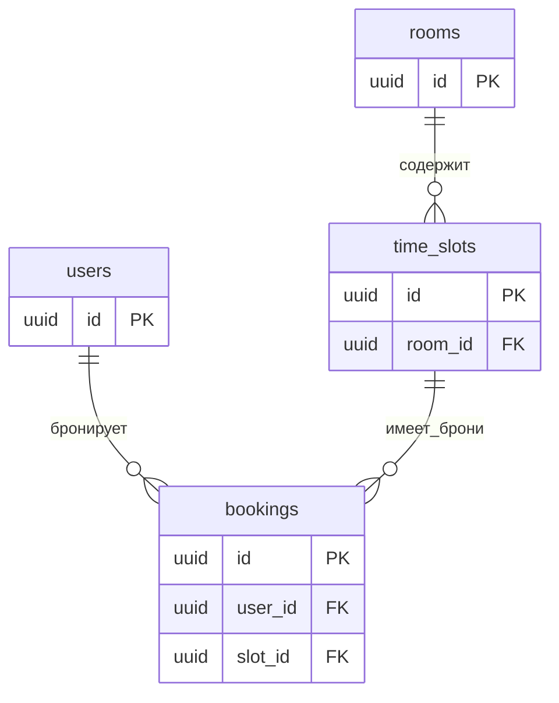

# Схема базы данных

# Нормализация

1 Комнату переименовали, но обновили только одну строку брони.

При переименовании действительно нужно обновить все строки броней этой комнаты. Если обновить не все, названия будут противоречить друг другу.

Название хранится в rooms, поэтому при переименовании изменяется одна запись комнаты.

2 Нужно сохранить новую комнату, которую ещё никто не бронировал.

Неизвестно как создать комнату без бронирования. 

Необходимо выделить в отдельную таблицу.

3 Удалили последнюю бронь комнаты, а сведения о комнате хранились только в бронях.

Если сведения о комнате хранятся только в бронях, удаление её последней брони приведёт к потере названия, вместимости и остальных сведений о комнате.

Комната хранится отдельно, поэтому удаление её последней брони не приводит к потере сведений о комнате.

## Словарь данных

### rooms

| Поле | Что означает | Тип PostgreSQL | Допускает NULL? | Ключ или правило |
|---|---|---|---|---|
| id | Идентификатор комнаты | uuid | Нет | Первичный ключ |
| name | Название комнаты | text | Нет | Обязательное поле |
| capacity | Вместимость комнаты | integer | Нет | >0 |
| has_projector | Наличие проектора | boolean | Нет | Обязательное поле |
| description | Описание комнаты | text | Да | Необязательное поле |

### users

| Поле | Что означает | Тип PostgreSQL | Допускает NULL? | Ключ или правило |
|---|---|---|---|---|
| id | Идентификатор пользователя | uuid | Нет | Первичный ключ |
| name | Имя пользователя | text| Нет | Обязательное поле |
| email | Почта пользователя | text | Нет | Уникальное значение. Для учебных данных — нижний регистр. |
| role | Роль пользователя | text | Нет | Допустимые значения: USER, ADMIN |

### time_slots

| Поле | Что означает | Тип PostgreSQL | Допускает NULL? | Ключ или правило |
|---|---|---|---|---|
| id | Идентификатор слота | uuid | Нет | Первичный ключ |
| room_id | Идентификатор комнаты | uuid| Нет | Внешний ключ |
| starts_at | Начало слота | timestamptz | Нет | Обязательное поле |
| ends_at | Конец слота | timestamptz | Нет | Обязательное поле |

**Правила времени слота:**
- `ends_at` ровно на 60 минут позже `starts_at`.
- `starts_at` приходится на целый час UTC: минуты, секунды и доли секунды равны нулю.
- Интервал считается полуоткрытым: `[starts_at, ends_at)`.

**Правило для нескольких полей:** сочетание `(room_id, starts_at)` должно быть уникальным.

### bookings

| Поле | Что означает | Тип PostgreSQL | Допускает NULL? | Ключ или правило |
|---|---|---|---|---|
| id | Идентификатор бронирования | uuid | Нет | Первичный ключ |
| user_id | Идентификатор пользователя | uuid | Нет | Внешний ключ |
| slot_id | Идентификатор слота | uuid| Нет | Внешний ключ; уникален среди броней ACTIVE |
| status | Статус бронирования | text | Нет | Допустимые значения: ACTIVE, CANCELLED. По умолчанию: ACTIVE |
| created_at | Время создания брони | timestamptz | Нет | Обязательное поле |

### Единственная активная бронь слота

Для одного `slot_id` допустима не более одной записи со статусом `ACTIVE`. Отменённые записи `CANCELLED` сохраняются в истории; их количество для слота не ограничивается этим правилом. После отмены можно создать новую бронь с новым UUID.

Правило обеспечивается частичным уникальным индексом `bookings_one_active_per_slot_idx` на `public.bookings`: ключ — `slot_id`, условие — `status = 'ACTIVE'`. Определение и сохранённый результат проверки через `pg_indexes` находятся в `sql/14-day-4-active-booking-index.sql`.

Обычная уникальность `slot_id` запретила бы повторное бронирование с сохранением истории. Уникальность `(slot_id, status)` ограничила бы историю одной отменённой записью. Предварительная проверка свободного слота не заменяет защиту БД от конкурентных вставок.

Индекс защищает конкретный слот от нескольких активных броней. Отсутствие пересечений разных слотов одной комнаты обеспечивается отдельно: длительностью 60 минут, началом в целый час UTC и уникальностью `(room_id, starts_at)`. Права пользователя и допустимое время бронирования/отмены этим индексом не проверяются.

# Решения по структуре
В bookings не копируем email пользователя, название комнаты и room_id, 
так как почта определяется через user_id и в дальнейшем может быть изменена.
Название комнаты хранится в rooms и также может быть изменено.
Значение room_id определяется через slot_id и копирование излишне.

Нельзя безусловно запретить повторение slot_id в бронях, 
так как у одного слота может быть несколько бронирований в истории (но только одно активное).

Уникальным должно быть сочетание комнаты и начала слота, а не только время начала,
так как в одно время может начинаться слот для нескольких комнат.

Для учебных данных используем нижний регистр email; обычная уникальность текста сама адрес не нормализует.
